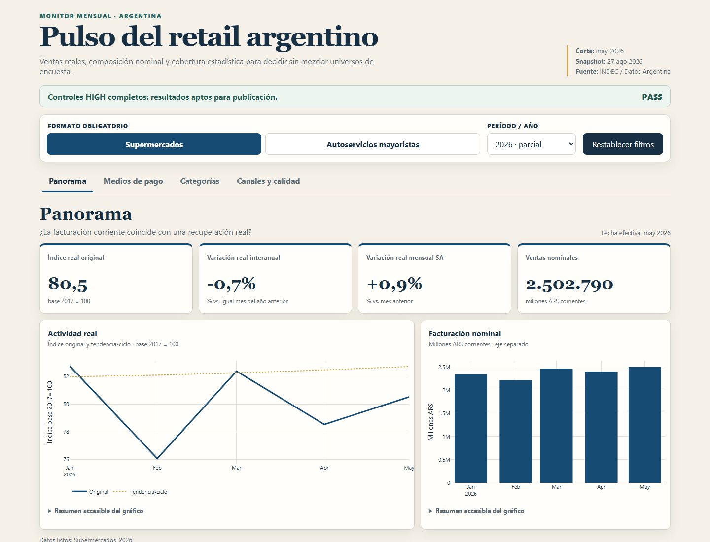

# Argentina retail pulse

Reproducible analytics case on monthly supermarket and wholesale self-service sales in
Argentina. It separates nominal growth from real performance and tracks payment, category
and channel mix from 2017 using Python, SQL Server and a versionable Power BI PBIP project.

The static HTML dashboard is published with GitHub Pages and works without SQL Server in
the browser. The complementary PBIX is distributed as a GitHub Release asset.

[Dashboard](https://alexanderhuth98.github.io/argentina-retail-sales/) |
[Release / PBIX](https://github.com/alexanderhuth98/argentina-retail-sales/releases/latest) |
[Case study / validation](reports/case_study_en.md) |
[Portfolio](https://alexanderhuth98.github.io/#proyectos)

## Case in 30 seconds

- **Problem:** nominal growth can hide a real contraction, and supermarkets and wholesale
  self-service stores represent different survey populations.
- **Verified finding:** in May 2026, supermarket sales grew `+25.9%` nominally year over
  year but fell `-0.7%` in real year-over-year terms.
- **Decision:** never add supermarkets and wholesale into one total; treat missing values
  as unobserved, never as zero.
- **Limitation:** 2026 is partial; wholesale channel detail runs only through August 2022.



## Verified latest results

**Latest observed month: May 2026; 2026 is partial.**

| Metric | Supermarkets | Wholesale self-service |
|---|---:|---:|
| Real original index, 2017=100 | `80.5` | `80.6` |
| Real year-over-year change | `-0.7%` | `-2.3%` |
| Seasonally adjusted month-over-month change | `+0.9%` | `+2.3%` |
| Nominal year-over-year change | `+25.9%` | `+23.7%` |

Nominal growth therefore did not imply real growth in May 2026. Credit represented
`45.0%` of supermarket sales, while other methods represented `32.3%` in wholesale.
Grocery was the largest nominal category in both formats (`27.1%` and `44.4%`). Online
share was `3.43%` for supermarkets; wholesale channel detail last reported `0.03%` in
August 2022. All `11` published `HIGH` checks passed.

The formats describe different survey populations and are never added into one market
total. Category, payment and channel values are current-price ARS and must not be read as
physical volume. Missing wholesale channel data after August 2022 remains null, not zero.

## Delivery

- Two official CSV snapshots with SHA-256 provenance.
- Five validated aggregate portfolio datasets with 3,966 rows.
- Typed SQL Server schemas, keys, indexes, analytical views and an atomic idempotent load.
- A mandatory `HIGH/PASS` gate before SQL publication.
- An 11-table Power BI model with conformed dimensions, explicit relationships and
  single-format business measures.
- Four PBIR pages with top KPIs, middle trends and bottom breakdowns.
- Pytest contracts, Ruff, GitHub CI, GitLab CI and a PowerShell PBIP validator.

## Run

```powershell
python -m venv .venv
.\.venv\Scripts\python.exe -m pip install -e ".[dev]"
.\.venv\Scripts\argentina-retail-sales.exe all
.\.venv\Scripts\python.exe -m pytest --cov=argentina_retail_sales --cov-report=term-missing
powershell.exe -NoProfile -ExecutionPolicy Bypass -File .\powerbi\validate_pbip.ps1 -SkipTom
```

See the [Spanish README](README.md), [English case study](reports/case_study_en.md),
[methodology](docs/methodology.md), [operations guide](docs/operations.md),
[SQL runbook](sql/README.md) and [Power BI guide](powerbi/README.md).

The source is official monthly data published through Datos Argentina with INDEC as the
source and CC BY 4.0 terms. Code and documentation are MIT licensed; MIT does not
relicense the source data.
